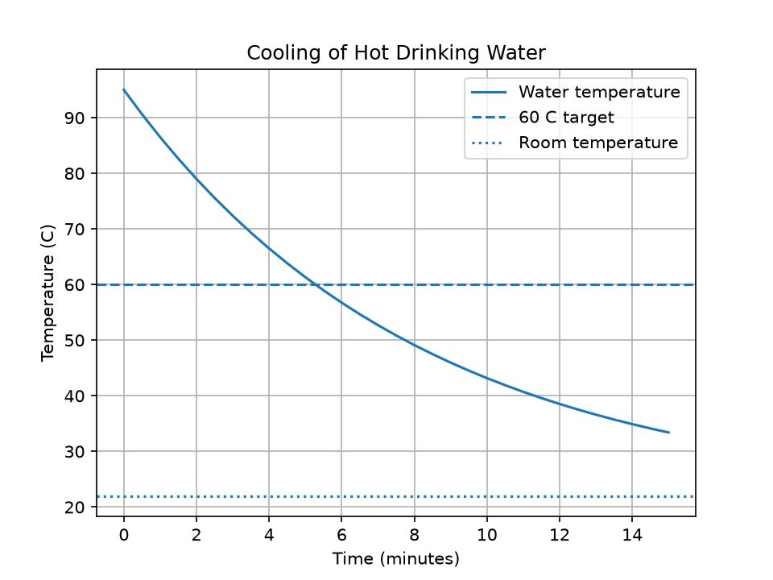

# Additional Real-World Case Study: Cooling of Hot Drinking Water

## 1. Introduction

This extension applies Euler's numerical method to a practical situation: estimating how freshly boiled drinking water cools after being placed in a room-temperature environment.

The original practical task investigated the cooling of an object. This extension applies the same numerical technique to drinking water and estimates how long it takes to reach a temperature of 60°C.

## 2. Objective

To use Euler's method to simulate the cooling of hot drinking water and estimate the time required for the water to reach 60°C.

## 3. Assumptions

The simulation uses the following assumptions:

- The water is initially at 95°C.
- The surrounding room temperature remains constant at 22°C.
- The water cools according to Newton's law of cooling.
- The cooling constant remains constant throughout the simulation.
- The water is sufficiently mixed to have a uniform temperature.
- Heat loss through evaporation and other effects is not modelled separately.

## 4. Input Parameters

| Parameter | Value |
|---|---:|
| Initial water temperature | 95°C |
| Room temperature | 22°C |
| Cooling constant | 0.12 per minute |
| Time step | 0.5 minutes |
| Simulation duration | 15 minutes |
| Target temperature | 60°C |

## 5. Mathematical Model

Newton's law of cooling is represented by:

\[
\frac{dT}{dt}=-k(T-T_a)
\]

Where:

- \(T\) is the water temperature.
- \(T_a\) is the surrounding room temperature.
- \(k\) is the cooling constant.
- \(t\) is time.

Euler's method approximates the next temperature using:

\[
T_{n+1}=T_n+\Delta t[-k(T_n-T_a)]
\]

The program repeatedly applies this formula to estimate the water temperature over time.

## 6. Results and Interpretation

The Python program calculates the water temperature after 5, 10 and 15 minutes. It also estimates the first simulated time at which the water reaches or falls below 60°C.

**Insert the actual terminal output here after running the program.**

The generated graph illustrates how the water temperature decreases over time and approaches room temperature.

## 7. Interpretation

The simulation demonstrates that the water cools more rapidly when its temperature is much higher than the surrounding room temperature. As the difference between the water and room temperatures decreases, the rate of cooling also decreases.

The 60°C reference line helps identify when the simulated water reaches the selected target temperature.

## 8. Limitations

The model assumes a constant room temperature and cooling coefficient. Actual cooling may be affected by the container material, container shape, water volume, airflow, evaporation and other environmental conditions.

Therefore, the results are numerical estimates rather than exact predictions of the cooling time in every real-world situation.

## 9. Conclusion

This extension demonstrates how Euler's numerical method can be applied to a different practical problem using the same underlying mathematical model. It shows how numerical methods can help estimate temperature changes and support everyday decisions involving hot water.
