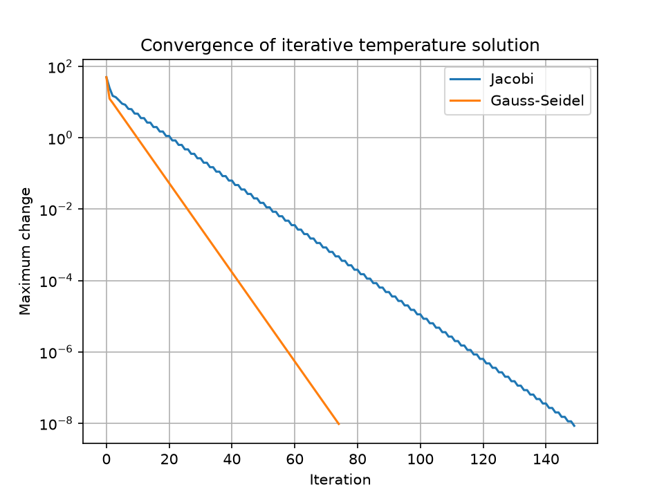
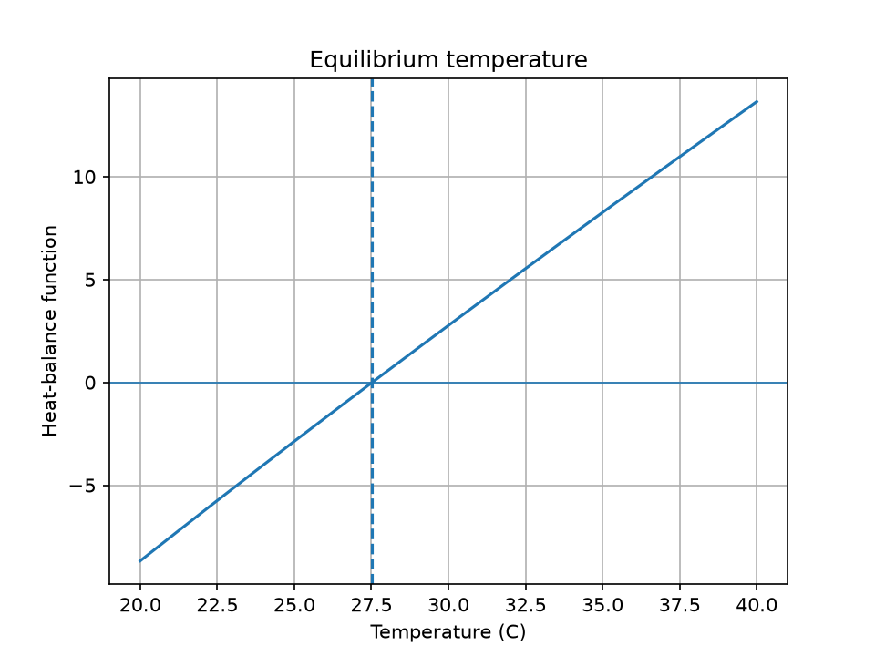
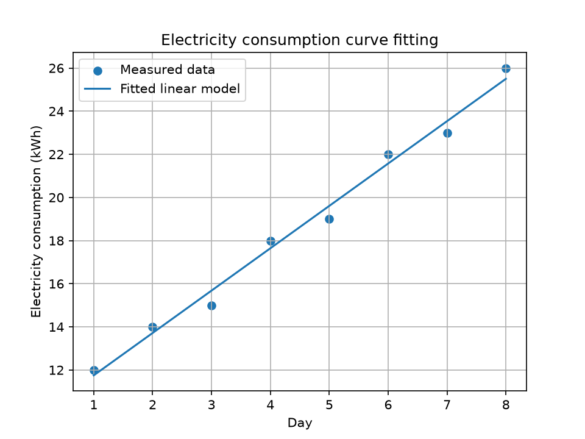
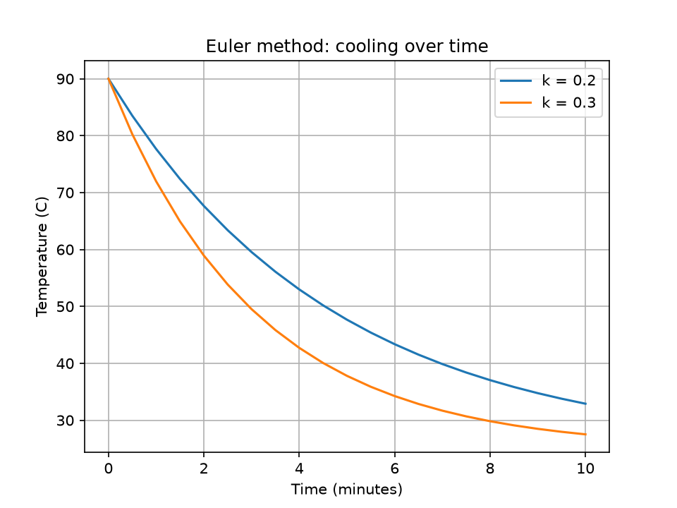
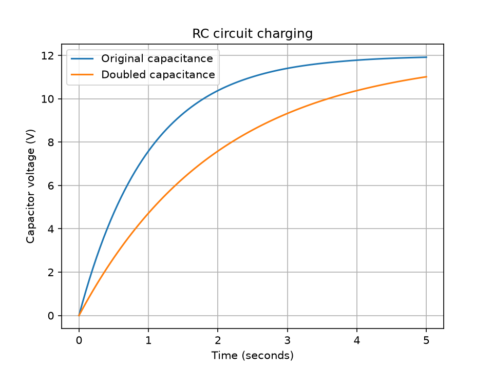

# BIT 2118 – SCIENTIFIC COMPUTING
## Practical Assignment Report: Tasks 2–20

**Student Name:** [Juanita Mumbi Irungu]  
**Registration Number:** [BSCCS/2025/47536]  
**Course:** BIT 2118 – Scientific Computing  
**Programming Language:** Python  
**Libraries:** NumPy, SciPy and Matplotlib  

---

# 1. Introduction

Scientific computing involves applying computational techniques and numerical methods to solve mathematical, scientific and engineering problems. This practical assignment explores the implementation of these techniques using Python.

The practical work covers numerical computation, matrix algebra, systems of linear equations, root-finding methods, interpolation, curve fitting, numerical differentiation, numerical integration, ordinary differential equations, optimization and Monte Carlo simulation.

The main objective was to understand how numerical algorithms work, implement them using appropriate Python libraries, interpret their outputs and examine how changes in input parameters affect numerical results.

# 2. Development Environment and Technologies

The practical programs were implemented using Python in an Ubuntu environment through Windows Subsystem for Linux (WSL).

The following libraries were used:

| Technology | Application |
|---|---|
| Python | Implementation of numerical algorithms |
| NumPy | Arrays, mathematical operations and linear algebra |
| SciPy | Numerical solvers, integration and optimization |
| Matplotlib | Visualization of numerical results |

## 2.1 Project Organization

The project is organized into three main directories:

- `code/` – Contains the Python implementations for Tasks 2–20.
- `results/` – Contains graphs generated by selected practical programs.
- `documentation/` – Contains the practical report and supporting documentation.

# 3. Practical Implementation and Results

## Task 2: NumPy Arrays and Numerical Computation

**Objective:**  
To demonstrate how NumPy arrays can store numerical data and perform efficient mathematical calculations.

**Input data and method:**  
Twenty-four hourly temperature readings were stored in a NumPy array. NumPy functions were used to calculate the mean, minimum and maximum temperatures. Selected Celsius values were converted to Fahrenheit using:

\[
F = \frac{9}{5}C + 32
\]

**Results:**

| Measurement | Result |
|---|---:|
| Mean temperature | 23.12°C |
| Minimum temperature | 17.50°C |
| Maximum temperature | 29.40°C |
| Mean after adding 2°C | 25.12°C |

**Interpretation:**  
The mean represents the average temperature across the recorded period. The minimum and maximum identify the lowest and highest readings.

Adding 2°C to every reading increased the mean by exactly 2°C. This demonstrates how array operations can modify an entire dataset efficiently.

**Practical application:**  
NumPy arrays can be used in weather monitoring, sensor-data processing and scientific data analysis.

---

## Task 3: Mathematical Functions and Vectorization

**Objective:**  
To compare conventional Python loops with NumPy vectorized operations.

**Input data and method:**  
One million simulated network-latency measurements were generated. Each value was squared using both a Python loop and a vectorized NumPy operation.

**Results:**

| Measurement | Result |
|---|---:|
| Loop execution time | 1.0082 seconds |
| Vectorized execution time | 0.0590 seconds |
| Approximate speed-up | 17.1 times |
| Smaller dataset size | 1,000 readings |
| Mean latency | 126.81 ms |

**Interpretation:**  
The vectorized operation executed considerably faster than the conventional loop. In this execution, it was approximately 17.1 times faster.

This improvement occurs because NumPy performs many operations using optimized numerical routines rather than repeatedly executing Python-level instructions.

**Parameter variation:**  
A smaller dataset containing 1,000 measurements was also examined. Reducing the dataset size reduces the amount of data being processed.

**Practical application:**  
Vectorization is useful in processing large datasets, network measurements, scientific simulations and machine-learning applications.

---

## Task 4: Floating-Point Arithmetic and Numerical Errors

**Objective:**  
To investigate floating-point representation and understand numerical errors in computer calculations.

**Method:**  
Floating-point addition, tolerance-based comparisons, absolute error, relative error and numerically stable expressions were examined.

**Results:**

```text
0.1 + 0.2 = 0.30000000000000004
Exact comparison: False
Tolerance-based comparison: True
Absolute error: 0.00021356
Relative error: 0.01510114%
```

For small values of x, the direct numerical expression also demonstrated loss of precision due to cancellation. A more stable algebraic expression produced more reliable approximations.

**Interpretation:**  
Computers represent many decimal numbers using binary floating-point values. Consequently, some decimal numbers cannot be represented exactly.

Tolerance-based comparisons are therefore more appropriate than exact equality checks when comparing floating-point results.

**Parameter variation:**  
The calculations were repeated using progressively smaller values of x. The direct expression became less accurate as cancellation increased.

**Practical application:**  
Understanding floating-point errors is important in financial calculations, scientific simulations and engineering computations where numerical accuracy matters.

---

## Task 5: Matrix Algebra and Matrix Operations

**Objective:**  
To perform matrix transformations using NumPy.

**Method:**  
A square was represented using four two-dimensional coordinate points. A transformation matrix combined rotation and scaling.

The determinant was calculated to examine whether the transformation was invertible.

**Results:**

```text
Determinant: approximately 3.0
```

Changing the rotation angle to 90 degrees produced a different orientation of the transformed square.

**Interpretation:**  
The nonzero determinant indicates that the transformation matrix is invertible.

Very small values close to zero in the transformed coordinates, such as values around \(10^{-16}\), are caused by floating-point round-off and are effectively zero.

**Parameter variation:**  
The rotation angle was changed to 90 degrees, demonstrating how changing a transformation parameter affects the resulting coordinates.

**Practical application:**  
Matrix transformations are used in computer graphics, robotics, image processing and geometric modeling.

---

## Task 6: Solution of Systems of Linear Equations

**Objective:**  
To solve simultaneous linear equations using NumPy.

**Input data:**

The server-resource allocation problem was represented by:

\[
4x + 2y = 20
\]

\[
8x + 12y = 72
\]

The system was solved using `numpy.linalg.solve()`.

**Results:**

```text
Type A servers: 3
Type B servers: 4
Residual: [0. 0.]
Residual norm: 0.0
```

When the available CPU units were changed to 24:

```text
Type A servers: 4.50
Type B servers: 3.00
```

**Interpretation:**  
The original system produces a solution of three Type A servers and four Type B servers.

The zero residual indicates that the calculated solution satisfies the original equations.

The changed input produced fractional values. These represent mathematical estimates; an actual server deployment would require whole-number constraints.

**Practical application:**  
Systems of linear equations can model resource allocation, electrical circuits, production planning and engineering systems.

---

## Task 7: Gaussian Elimination and LU Decomposition

**Objective:**  
To solve systems of linear equations using Gaussian elimination and LU decomposition.

**Method:**  
The coefficient matrix was factorized and used to solve several measurement sets.

**Results:**

| Measurement set | Solution |
|---|---|
| Set 1 | [5.0000, 5.0000, 5.0000] |
| Set 2 | [5.3171, 5.2683, 4.7561] |
| Set 3 | [4.9024, 5.6098, 5.5366] |

The residual norms were zero or extremely close to zero.

Changing the measurements in the first set produced:

```text
[5.85365854, 5.41463415, 5.80487805]
```

**Interpretation:**  
The results demonstrate that the numerical methods successfully solved the systems.

LU decomposition is particularly useful when multiple systems share the same coefficient matrix because the factorization can be reused with different right-hand-side vectors.

**Practical application:**  
These methods are useful in structural engineering, circuit analysis, scientific modeling and numerical simulations.

---

## Task 8: Iterative Methods for Linear Systems

**Objective:**  
To compare Jacobi and Gauss-Seidel iterative methods for solving linear systems.

**Method:**  
The methods were applied to estimate steady-state temperatures at five interior points between fixed boundary temperatures.

**Results:**

```text
Jacobi temperatures:
[86.66666665 73.33333331 59.99999997 46.66666664 33.33333332]

Gauss-Seidel temperatures:
[86.66666665 73.33333330 59.99999997 46.66666665 33.33333332]

Jacobi iterations: 150
Gauss-Seidel iterations: 75
```

The direct solution was approximately:

```text
[86.67 73.33 60.00 46.67 33.33]
```

After changing the left boundary temperature:

```text
[103.33 86.67 70.00 53.33 36.67]
```

**Interpretation:**  
Both iterative methods converged to results that closely matched the direct solution.

Gauss-Seidel required 75 iterations, compared with 150 for Jacobi, in this particular execution.

Changing the left boundary temperature affected the temperature distribution throughout the system.

**Graph:**



**Practical application:**  
Iterative methods are used in heat-transfer modeling, fluid mechanics and large-scale engineering simulations.

---

## Task 9: Eigenvalues and Eigenvectors

**Objective:**  
To calculate eigenvalues and eigenvectors and use them to examine network importance.

**Method:**  
An adjacency matrix represented connections between four network nodes. The dominant eigenvector was used to calculate eigenvector-based importance scores.

**Results:**

```text
Dominant eigenvalue: 2.5615528128

A: 0.2192
B: 0.2808
C: 0.2808
D: 0.2192
```

After adding a connection between A and D:

```text
A: 0.2500
B: 0.2500
C: 0.2500
D: 0.2500
```

**Interpretation:**  
Nodes B and C initially had higher importance scores because of their positions within the network.

Adding the connection between A and D changed the network structure and produced equal importance scores.

The verification error was approximately \(2.8 \times 10^{-15}\), indicating close numerical agreement.

**Practical application:**  
Eigenvector centrality is used in network analysis, social networks, web-page ranking and interconnected systems.

---

## Task 10: Root Finding – Bisection and Fixed-Point Iteration

**Objective:**  
To solve a nonlinear equilibrium-temperature equation using two root-finding methods.

**Method:**  
The bisection method and fixed-point iteration were implemented to approximate the equilibrium temperature.

**Results:**

| Method | Equilibrium temperature |
|---|---:|
| Bisection | 27.525211°C |
| Fixed-point iteration | 27.525211°C |

Fixed-point iteration converged in 13 iterations.

After changing a model parameter, the equilibrium temperature became:

```text
30.208195°C
```

**Interpretation:**  
Both methods converged to the same equilibrium temperature, providing a useful comparison of their numerical behavior.

The parameter change increased the equilibrium temperature.

**Graph:**



**Practical application:**  
Root-finding methods can be used to determine equilibrium conditions in thermal systems, engineering models and scientific equations.

---

## Task 11: Root Finding – Newton-Raphson and Secant Methods

**Objective:**  
To compare Newton-Raphson and Secant methods when calculating the internal rate of return of an investment.

**Method:**  
The internal rate of return (IRR) was found by solving the equation:

\[
NPV(r) = 0
\]

Newton-Raphson uses derivative information, while the Secant method approximates the derivative using two points.

**Results:**

```text
IRR using Newton-Raphson: 11.542461%
IRR using Secant method: 11.542461%
NPV at Newton solution: approximately 0
```

After increasing the initial investment:

```text
IRR: 3.329828%
```

**Interpretation:**  
Both methods produced the same IRR, showing agreement between the numerical approaches.

Increasing the initial investment reduced the calculated return on investment under the modeled cash flows.

**Practical application:**  
Root-finding techniques are useful in financial analysis, investment planning and engineering calculations.

---

## Task 12: Polynomial and Nonlinear Equation Solving

**Objective:**  
To solve nonlinear equations and determine intersection points between mathematical curves.

**Method:**  
SciPy's nonlinear equation solver was used with different initial guesses.

**Results:**

| Initial guess | Intersection |
|---|---|
| [1, 1] | [1.51749, 1.30278] |
| [-1, 1] | [-1.51749, 1.30278] |

Both solutions converged successfully, with residuals close to zero.

After changing the circle radius to 3:

```text
[1.83637723, 2.37228132]
```

**Interpretation:**  
Different initial guesses led the solver to different valid intersections.

This demonstrates that nonlinear systems can have multiple solutions and that the initial guess can influence which solution is found.

**Practical application:**  
Nonlinear equation solving is used in engineering design, physical modeling and scientific analysis.

---

## Task 13: Interpolation

**Objective:**  
To estimate unknown values between known data points using interpolation.

**Input data:**  
Water-level measurements were recorded at two-hour intervals.

| Time (hours) | Water level (m) |
|---:|---:|
| 0 | 1.2 |
| 2 | 1.8 |
| 4 | 2.5 |
| 6 | 3.1 |
| 8 | 3.8 |

**Method:**  
Linear interpolation was used to estimate water levels between recorded measurements.

**Results:**

| Time | Estimated water level |
|---:|---:|
| 1 hour | 1.500 m |
| 3 hours | 2.150 m |
| 5 hours | 2.800 m |
| 7 hours | 3.450 m |

After changing the measurement at hour 4, the estimated level at hour 3 became 2.35 m.

**Interpretation:**  
Interpolation estimates values between known observations.

Changing one of the recorded measurements affects estimates in the surrounding interval.

**Practical application:**  
Interpolation is useful in weather monitoring, sensor measurements, scientific experiments and time-series analysis.

---

## Task 14: Curve Fitting

**Objective:**  
To fit a mathematical model to observed data and make predictions.

**Method:**  
A straight-line model was fitted to energy-consumption observations using:

\[
y = mx + c
\]

where \(m\) represents the slope and \(c\) represents the intercept.

**Results:**

| Measurement | Result |
|---|---:|
| Fitted slope | 1.9643 |
| Fitted intercept | 9.7857 |
| Predicted day 9 consumption | 27.4643 |
| Changed-data slope | 2.2143 |

**Interpretation:**  
The positive slope indicates an increasing trend in energy consumption.

Changing the final measurement increased the fitted slope, showing how input observations influence the fitted model.

Residuals represent differences between actual observations and predicted values.

**Graph:**



**Practical application:**  
Curve fitting is useful in forecasting, trend analysis, experimental data analysis and scientific modeling.

---

## Task 15: Numerical Differentiation

**Objective:**  
To estimate velocity and acceleration from position measurements.

**Method:**  
Numerical differentiation was performed using NumPy's gradient function.

Velocity is the derivative of position:

\[
v(t) = \frac{dx}{dt}
\]

Acceleration is the derivative of velocity:

\[
a(t) = \frac{dv}{dt}
\]

**Results:**

```text
Estimated velocity:
[4. 5. 7. 9. 11. 12.] m/s

Estimated acceleration:
[1. 1.5 2. 2. 1.5 1.] m/s²
```

Changing the position measurement at 3 seconds affected nearby velocity estimates.

**Interpretation:**  
The numerical derivative estimates how quickly position changes over time. The second derivative describes how velocity changes.

The results also demonstrate that numerical differentiation can be sensitive to changes in measured data.

**Practical application:**  
Numerical differentiation is used in motion analysis, robotics, physics and engineering systems.

---

## Task 16: Numerical Integration

**Objective:**  
To estimate accumulated energy consumption using numerical integration.

**Input data:**  
Power readings were recorded over a five-hour period.

**Method:**  
The trapezoidal and Simpson's rules were used to estimate the area under the power-time curve.

Energy is calculated by integrating power over time:

\[
E = \int P(t)\,dt
\]

**Results:**

| Method | Energy estimate |
|---|---:|
| Trapezoidal rule | 9.0000 kWh |
| Simpson's rule | 9.2083 kWh |
| Simpson's rule after 20% increase | 11.0500 kWh |

**Interpretation:**  
Both numerical methods estimated the total energy consumed.

Simpson's rule produced a slightly higher estimate because it uses a different approximation of the area under the curve.

Increasing the power readings by 20% increased the estimated energy consumption by 20%.

**Practical application:**  
Numerical integration is used in electricity consumption analysis, distance calculations, fluid-flow analysis and engineering measurements.

---

## Task 17: Ordinary Differential Equations – Euler Method

**Objective:**  
To approximate the solution of an ordinary differential equation using Euler's method.

**Method:**  
The cooling model was represented by:

\[
\frac{dT}{dt} = -k(T - T_{\text{room}})
\]

The initial temperature was 90°C, room temperature was 25°C and the time step was 0.5 minutes.

**Results:**

| Measurement | Temperature |
|---|---:|
| Initial temperature | 90.00°C |
| After 5 minutes | 47.6641°C |
| After 10 minutes | 32.9025°C |
| After 10 minutes with faster cooling | 27.5194°C |

**Interpretation:**  
The temperature decreases over time and approaches room temperature.

Increasing the cooling constant from 0.2 to 0.3 resulted in faster cooling.

**Graph:**



**Practical application:**  
Euler's method can model cooling, population changes, chemical reactions and other systems that change over time.

---

## Task 18: Numerical Solution of ODEs Using SciPy

**Objective:**  
To solve an ordinary differential equation using SciPy's numerical integration tools.

**Method:**  
An RC circuit charging model was implemented:

\[
\frac{dV}{dt} = \frac{V_{\text{in}}-V}{RC}
\]

The input voltage was 12 V, resistance was 1,000 Ω and initial capacitance was 0.001 F.

The `solve_ivp()` function was used to calculate the capacitor voltage over time.

**Results:**

| Measurement | Voltage |
|---|---:|
| Initial voltage | 0 V |
| After 1 second | 7.5856 V |
| After 5 seconds | 11.9177 V |
| After 5 seconds with doubled capacitance | 11.0141 V |

The solver reported successful execution.

**Interpretation:**  
The capacitor voltage increases towards the 12 V supply.

Doubling capacitance increases the charging time, resulting in a lower voltage after the same five-second interval.

**Graph:**



**Practical application:**  
ODE solvers are useful in electrical circuit analysis, physical systems, chemical processes and engineering simulations.

---

## Task 19: Numerical Optimization

**Objective:**  
To determine the least-cost combination of two electricity sources while meeting a specified energy demand.

**Method:**  
SciPy's `minimize()` function was used to minimize:

\[
C = 5x + 8y
\]

subject to:

\[
x + y \geq 100
\]

with the supply limits:

\[
0 \leq x \leq 80
\]

\[
0 \leq y \leq 70
\]

Here, \(x\) represents electricity from Source A and \(y\) represents electricity from Source B.

**Results:**

| Demand | Source A | Source B | Minimum cost |
|---:|---:|---:|---:|
| 100 kWh | 80 kWh | 20 kWh | 560 |
| 120 kWh | 80 kWh | 40 kWh | 720 |

**Interpretation:**  
Source A is cheaper than Source B, so the optimizer uses its full available capacity before purchasing additional electricity from Source B.

Increasing demand from 100 kWh to 120 kWh increased the minimum cost from 560 to 720 units.

**Practical application:**  
Numerical optimization is used in energy planning, logistics, production scheduling and resource allocation.

---

## Task 20: Random Numbers and Monte Carlo Methods

**Objective:**  
To estimate the mathematical constant π using random sampling.

**Method:**  
Random points were generated within a square extending from -1 to 1 on both axes.

The proportion of points inside a unit circle was used to estimate π:

\[
\pi \approx 4 \times
\frac{\text{Number of points inside the circle}}
{\text{Total number of points}}
\]

**Results:**

| Number of points | Estimated π | Absolute error |
|---:|---:|---:|
| 10,000 | 3.125600 | 0.015993 |
| 100,000 | 3.145640 | — |
| 1,000,000 | 3.142148 | 0.000555 |

The actual value of π is approximately 3.14159265.

**Interpretation:**  
The estimate obtained using one million points was closer to the actual value than the estimate obtained using 10,000 points.

Increasing the number of random samples generally improves the accuracy of Monte Carlo estimates, although individual estimates can vary because of randomness.

**Practical application:**  
Monte Carlo methods are used in probability estimation, financial risk analysis, scientific simulation and numerical approximation.

# 4. Overall Discussion

The practical tasks demonstrated how different numerical methods can be used to solve computational problems.

Several important observations were made:

1. **Efficient numerical computation:** NumPy vectorization performed substantially faster than conventional Python loops in the large-data example.
2. **Numerical accuracy:** Floating-point calculations can introduce small errors, making tolerance-based comparisons important.
3. **Linear algebra:** Matrix operations, Gaussian elimination and LU decomposition provide effective ways of solving systems of equations.
4. **Iterative methods:** Jacobi and Gauss-Seidel approximate solutions through repeated calculations and can be compared using convergence behavior.
5. **Root finding:** Bisection, fixed-point iteration, Newton-Raphson and Secant methods can approximate solutions to nonlinear equations.
6. **Data approximation:** Interpolation and curve fitting help estimate unknown values and identify trends in measured data.
7. **Calculus applications:** Numerical differentiation and integration estimate rates of change and accumulated quantities from discrete data.
8. **Dynamic systems:** Euler's method and SciPy ODE solvers model systems that change over time.
9. **Optimization:** Numerical optimization identifies efficient solutions under specified constraints.
10. **Random simulation:** Monte Carlo methods use random sampling to estimate mathematical quantities.

The parameter variations also demonstrated that numerical results depend on the selected input values and model assumptions.

# 5. Assumptions and Limitations

The practical programs use simplified numerical models and illustrative datasets to demonstrate the selected methods.

Some important limitations include:

- Floating-point calculations may contain small rounding errors.
- Numerical methods produce approximations rather than always providing exact solutions.
- Iterative methods depend on convergence conditions and stopping tolerances.
- Nonlinear solvers may converge to different roots depending on initial guesses.
- Interpolation and curve fitting depend on the quality and distribution of the available data.
- Numerical differentiation can amplify measurement errors.
- Monte Carlo estimates are affected by random sampling variation.
- Optimization results depend on the objective function, constraints and assumptions.

The execution times and random simulation results may differ across computers and repeated executions.

# 6. Conclusion

The Scientific Computing practical assignment provided experience in implementing numerical methods using Python and its scientific libraries.

Through Tasks 2–20, different computational approaches were applied to mathematical, scientific, engineering and resource-management problems.

The practical work demonstrated the importance of selecting suitable numerical algorithms, understanding numerical accuracy, interpreting computational results and examining the effects of changing input parameters.

Overall, the assignment strengthened practical understanding of scientific computing and demonstrated how numerical techniques can be applied to solve real-world problems.

# 7. References

1. NumPy Documentation. https://numpy.org/doc/
2. SciPy Documentation. https://docs.scipy.org/doc/scipy/
3. Matplotlib Documentation. https://matplotlib.org/stable/
4. Python Documentation. https://docs.python.org/3/
5. BIT 2118 Scientific Computing course materials and practical assignment instructions.

---

**Project Repository:**  
https://github.com/Algo-jtx/BIT2118-Scientific-Computing
